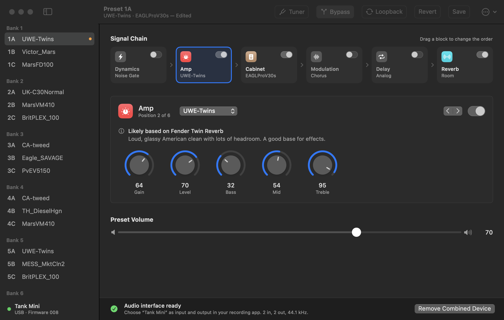

# Tank Mini for Mac

A native macOS editor for the M-VAVE Tank Mini guitar/bass multi-effects pedal, over USB.
Unofficial: not made by or affiliated with M-VAVE.

[Português (Brasil)](README.pt-BR.md)



## What it does

- **Presets**: all 21 presets (banks 1–7, A/B/C) in the sidebar. The app follows the pedal's footswitches.
- **Signal chain**: switch the six blocks on and off, and reorder them by dragging.
- **Editing**: pick a model for each block and turn its knobs; the pedal changes as you drag. Double-click a knob to put it back to the saved value.
- **Model notes**: a line under each model says what real amp or cabinet it appears to be based on and how it sounds.
- **Save**: store the sound in the current preset or any other slot. Nothing is stored until you save.
- **Tuner**, **Bypass**, **USB Loopback**.
- **Preset files**: export and load `.tkm` presets and `.atkm` banks, the same formats the official app uses.
- **Audio interface fix**: one click creates a combined “Tank Mini” audio device (see below).
- English and Brazilian Portuguese, light and dark mode.

## The audio interface problem

No driver is needed: the pedal is USB class-compliant and macOS's built-in drivers handle it.
The catch is that the pedal's firmware declares recording and playback as two separate USB
audio functions, so macOS lists two devices, both called “USB-Audio”: one input-only, one
output-only. Apps that want a single device for both directions can't use that.

**Create Combined Device** in the app's bottom bar builds one aggregate device named
“Tank Mini” (2 in, 2 out, 44.1 kHz) that any recording app can select. The pedal only runs
at 44.1 kHz, so set your project to that.

If you hear your guitar doubled in headphones plugged into the pedal, turn off input
monitoring in your recording app: the pedal already plays your direct sound.

## Requirements

- macOS 14 or later, Apple silicon or Intel
- Xcode Command Line Tools (`xcode-select --install`). Full Xcode is not required.
- Tested with one pedal on firmware `TANK MINI_008`

## Build and run

```sh
./make-app.sh
open "dist/Tank Mini.app"
```

`make-app.sh` also builds `dist/tankctl`, a read-only command-line tool:

```sh
dist/tankctl state      # firmware, active preset, the patch that is playing
dist/tankctl presets    # all 21 stored presets
dist/tankctl backup presets.atkm
```

Run the app without a pedal using sample data: `"dist/Tank Mini.app/Contents/MacOS/TankMini" --demo`

## Safety

- Edits go to the pedal's live edit buffer. Only **Save** writes the pedal's memory.
- Every time the app connects and finds the presets changed, it copies all 21 to
  `~/Library/Application Support/TankMini/Backups`.
- The protocol's erase command, factory reset and amp/IR model upload are deliberately not implemented.
- This is reverse-engineered software. Use it at your own risk.

## What has and hasn't been tested

Verified on a real pedal: reading the firmware name, the playing patch, all presets, the amp
and cabinet name tables and the tuner block; one acknowledged write; the combined audio
device running in both directions.

Not yet verified end to end: saving to the pedal's memory, the tuner display with an
instrument, drag-to-reorder, and the meaning of the bypass status byte on firmware 008.

## How it talks to the pedal

The pedal exposes a USB-MIDI port and speaks a vendor protocol in SysEx messages:
`F0 <7-bit packed frame> F7`, where a frame is `00 59 | cmd | length (u24 LE) | body | checksum`.
A preset is 92 bytes: volume, chain order, on/off flags, model per block and 36 parameters.
See [`Sources/TankMiniCore`](Sources/TankMiniCore) for the details.

The protocol was reverse-engineered by the community. This app is built on those notes and
re-checks them on real hardware:

- [viniciusapl97/tankmini-linux](https://github.com/viniciusapl97/tankmini-linux): protocol documentation and a native Linux app
- [xxyurirangelxx/mvave-tank-mini-protocol](https://github.com/xxyurirangelxx/mvave-tank-mini-protocol)
- [xxyurirangelxx/opentank-mini](https://github.com/xxyurirangelxx/opentank-mini)
- [michaelforney's notes on the M-VAVE SysEx framing](https://gist.github.com/michaelforney/d3a2790bb5f8cbcb1c931eabb50b5f20)

Since firmware `2025_05_16` the pedal also answers standard MIDI: Program Change 0–20 selects
presets 1–21, and CC 0–5 switches the FX, AMP, MOD, DLY, REV and CAB blocks.

## About the model notes

M-VAVE does not publish which real gear its amp and cabinet models come from. The “based on”
lines are read from the pedal's own abbreviated model names, so each is marked *likely* or
*possibly*. Product and company names belong to their owners and appear only to describe a sound.

## Layout

| Path | What |
| --- | --- |
| `Sources/TankMiniCore` | Protocol, MIDI link, preset model, model catalogue |
| `Sources/TankMiniApp` | The SwiftUI app |
| `Sources/tankctl` | Read-only command-line tool |
| `Resources` | App icon and translations |
| `Tools` | Icon generator and the USB audio / MIDI probes used during development |

## License

[MIT](LICENSE)
