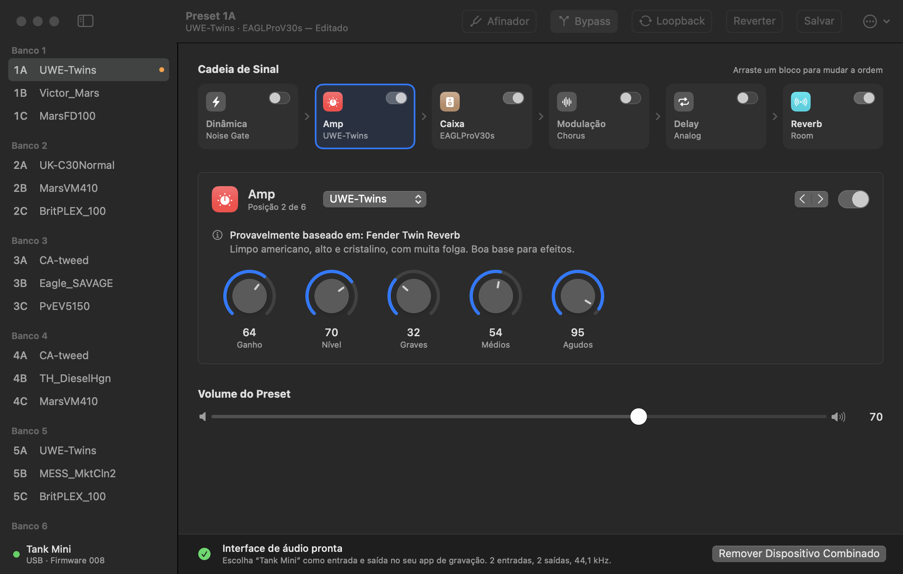

# Tank Mini para Mac

Um editor nativo para macOS da pedaleira multiefeitos M-VAVE Tank Mini (guitarra e baixo), por USB.
Não oficial: não é feito pela M-VAVE nem tem vínculo com ela.

[English](README.md)



## O que ele faz

- **Presets**: os 21 presets (bancos 1–7, A/B/C) na barra lateral. O app acompanha os footswitches da pedaleira.
- **Cadeia de sinal**: ligue e desligue os seis blocos e mude a ordem arrastando.
- **Edição**: escolha o modelo de cada bloco e gire os knobs; a pedaleira muda enquanto você arrasta. Clique duas vezes em um knob para voltar ao valor salvo.
- **Notas dos modelos**: uma linha abaixo de cada modelo diz em qual amplificador ou caixa real ele parece se basear e como soa.
- **Salvar**: grave o som no preset atual ou em qualquer outro. Nada é gravado até você salvar.
- **Afinador**, **Bypass**, **Loopback USB**.
- **Arquivos de preset**: exporte e carregue presets `.tkm` e bancos `.atkm`, os mesmos formatos do app oficial.
- **Correção da interface de áudio**: um clique cria um dispositivo de áudio combinado “Tank Mini” (veja abaixo).
- Inglês e português do Brasil, modo claro e escuro.

## O problema da interface de áudio

Não é preciso driver: a pedaleira segue o padrão USB e os drivers do próprio macOS dão conta.
O problema é que o firmware declara gravação e reprodução como duas funções de áudio USB
separadas, então o macOS mostra dois dispositivos, ambos chamados “USB-Audio”: um só de
entrada e outro só de saída. Apps que precisam de um único dispositivo para as duas direções
não conseguem usar isso.

O botão **Criar Dispositivo Combinado**, na barra inferior do app, cria um dispositivo
agregado chamado “Tank Mini” (2 entradas, 2 saídas, 44,1 kHz) que qualquer app de gravação
pode escolher. A pedaleira só trabalha em 44,1 kHz, então configure o projeto assim.

Se você ouvir a guitarra duplicada no fone ligado à pedaleira, desligue o monitoramento de
entrada no app de gravação: a pedaleira já toca o seu som direto.

## Requisitos

- macOS 14 ou posterior, Apple silicon ou Intel
- Xcode Command Line Tools (`xcode-select --install`). O Xcode completo não é necessário.
- Testado com uma pedaleira no firmware `TANK MINI_008`

## Compilar e abrir

```sh
./make-app.sh
open "dist/Tank Mini.app"
```

O `make-app.sh` também compila o `dist/tankctl`, uma ferramenta de linha de comando que só lê:

```sh
dist/tankctl state      # firmware, preset ativo, o som que está tocando
dist/tankctl presets    # os 21 presets gravados
dist/tankctl backup presets.atkm
```

Para abrir o app sem pedaleira, com dados de exemplo: `"dist/Tank Mini.app/Contents/MacOS/TankMini" --demo`

## Segurança

- As edições vão para o buffer de edição da pedaleira. Só o **Salvar** grava na memória dela.
- Sempre que o app conecta e encontra os presets alterados, ele copia os 21 para
  `~/Library/Application Support/TankMini/Backups`.
- O comando de apagar do protocolo, a restauração de fábrica e o envio de modelos de amp/IR não foram implementados, de propósito.
- Este software vem de engenharia reversa. Use por sua conta e risco.

## O que foi e o que não foi testado

Verificado em uma pedaleira real: leitura do nome do firmware, do som que está tocando, de
todos os presets, das tabelas de nomes de amps e caixas e do bloco do afinador; uma escrita
confirmada pela pedaleira; o dispositivo de áudio combinado funcionando nas duas direções.

Ainda não verificado de ponta a ponta: salvar na memória da pedaleira, o afinador com um
instrumento, reordenar arrastando, e o significado do byte de bypass no firmware 008.

## Como ele conversa com a pedaleira

A pedaleira expõe uma porta USB-MIDI e usa um protocolo próprio em mensagens SysEx:
`F0 <quadro empacotado em 7 bits> F7`, em que o quadro é `00 59 | cmd | tamanho (u24 LE) | corpo | checksum`.
Um preset tem 92 bytes: volume, ordem da cadeia, liga/desliga, modelo de cada bloco e 36 parâmetros.
Os detalhes estão em [`Sources/TankMiniCore`](Sources/TankMiniCore).

O protocolo foi levantado pela comunidade por engenharia reversa. Este app se apoia nessas
notas e as confere no hardware real:

- [viniciusapl97/tankmini-linux](https://github.com/viniciusapl97/tankmini-linux): documentação do protocolo e um app nativo para Linux
- [xxyurirangelxx/mvave-tank-mini-protocol](https://github.com/xxyurirangelxx/mvave-tank-mini-protocol)
- [xxyurirangelxx/opentank-mini](https://github.com/xxyurirangelxx/opentank-mini)
- [Notas de michaelforney sobre o formato SysEx da M-VAVE](https://gist.github.com/michaelforney/d3a2790bb5f8cbcb1c931eabb50b5f20)

Desde o firmware `2025_05_16` a pedaleira também responde a MIDI padrão: Program Change 0–20
seleciona os presets 1–21, e os CC 0–5 alternam os blocos FX, AMP, MOD, DLY, REV e CAB.

## Sobre as notas dos modelos

A M-VAVE não divulga de quais equipamentos reais vêm seus modelos de amplificador e caixa.
As linhas “baseado em” foram deduzidas dos nomes abreviados da própria pedaleira, por isso
cada uma traz *provavelmente* ou *possivelmente*. Nomes de produtos e empresas pertencem aos
seus donos e aparecem só para descrever um som.

## Organização

| Caminho | O quê |
| --- | --- |
| `Sources/TankMiniCore` | Protocolo, conexão MIDI, modelo de preset, catálogo de modelos |
| `Sources/TankMiniApp` | O app em SwiftUI |
| `Sources/tankctl` | Ferramenta de linha de comando, só leitura |
| `Resources` | Ícone do app e traduções |
| `Tools` | Gerador do ícone e as sondas de áudio USB / MIDI usadas no desenvolvimento |

## Licença

[MIT](LICENSE)
